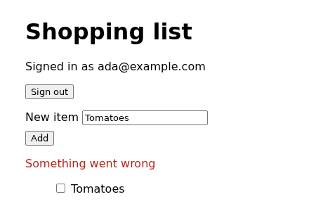

+++
title = 'How tomato tests a web UI'
date = 2026-10-22T00:30:00+02:00
summary = "tomato's browser resource drives a real Chromium the way a person does: it finds fields and buttons by the names people read, waits for the page instead of sleeping, and starts every scenario signed out. Here is what happens on each step, from the click to the database row it wrote."
tags = ['browser', 'ui', 'black-box testing']
+++

A test for a web UI usually breaks for reasons that have nothing to do with
the UI: a CSS class was renamed, an animation was slower than a `sleep`, the
last test left a user signed in. tomato's `browser` resource is built to avoid
all three. A step says what a person would do, `clicks "Sign in"`. tomato finds
the button the way a person would, waits as long as the page needs, and closes
the person's browser before the next scenario.

Step through a sign-in, from the scenario down to the database:



## The suite

Chromium runs in a container from the `chromium` preset. Each `browser`
resource is one person using it:

```yaml
version: 2

containers:
  postgres:
    image: postgres:17-alpine
    env: { POSTGRES_USER: shop, POSTGRES_PASSWORD: shop, POSTGRES_DB: shop }
    ports: ["5432/tcp"]
    wait_for: { type: exec, target: "pg_isready -h 127.0.0.1 -U shop" }
  chrome:
    preset: chromium              # headless Chromium, in a container

app:
  command: node app.js
  port: 3000
  ready: { type: http, path: /health }
  env:
    PORT: "3000"
    DATABASE_URL: "postgres://shop:shop@{{.postgres.host}}:{{.postgres.port.5432}}/shop"

resources:
  shop-db:
    type: postgres
    container: postgres
    database: shop
    options: { user: shop, password: shop }

  ada-browser:                    # one person
    type: browser
    container: chrome
    options: { base_url: "http://localhost:3000" }
```

The app runs on your machine and Chromium runs in a container, yet
`base_url` is plain `localhost`. tomato points the name `localhost` inside
Chromium at your machine, through a tunnel to each port the suite uses. The
page keeps the origin a real user would see, so cookies, CORS, redirects and
the secure context that browsers only grant `localhost` over plain HTTP all
behave as they would for that user.

The scenarios from the walkthrough:

```gherkin
Feature: Signing in

  Background:
    Given "shop-db" executes:
      """
      INSERT INTO users VALUES ('ada@example.com', crypt('tomato123', gen_salt('bf')));
      """

  Scenario: The right password opens the list
    Given "ada-browser" opens "/"
    When "ada-browser" fills "Email" with "ada@example.com"
    And "ada-browser" fills "Password" with "tomato123"
    And "ada-browser" clicks "Sign in"
    Then "ada-browser" sees "Signed in as ada@example.com" within "3s"
    And "ada-browser" url is "/list"
    And "shop-db" table "sessions" has "1" rows

  Scenario: A wrong password is refused
    Given "ada-browser" opens "/"
    When "ada-browser" fills "Email" with "ada@example.com"
    And "ada-browser" fills "Password" with "potato"
    And "ada-browser" clicks "Sign in"
    Then "ada-browser" sees "Wrong email or password" within "3s"
    And "shop-db" table "sessions" is empty
```

The page has nothing in it for tests: no `data-testid`, no ids. Only the HTML
a screen reader needs anyway:

```html
<h1>Sign in</h1>
<form method="post" action="/login">
  <label>Email <input name="email" type="email"></label>
  <label>Password <input name="password" type="password"></label>
  <button>Sign in</button>
</form>
```

## Finding things by name

A step names an element the way a person would talk about it, and tomato
looks it up in the page's **accessibility tree**, the same names a screen
reader announces:

| The step says | It finds |
|---|---|
| `fills "Email"` | the field labelled *Email*: its `<label>`, `aria-label` or placeholder |
| `clicks "Sign in"` | the button, link or tab called *Sign in*, or else the element showing that text |
| `checks "Tomatoes"` | the checkbox labelled *Tomatoes*, whether the text is on the box or its label |
| `selects "Austria" from "Country"` | a `<select>`, or a combobox the page draws itself |
| `sees "…"` | any text the page shows, including what fields hold |

Three rules follow, and each one is the same rule a person or a screen reader
already lives by:

- **A control beats text.** The sign-in page has a heading *and* a button
  called "Sign in". A person clicking "Sign in" means the button, and so does
  tomato.
- **No name, no element.** A field without a label can't be found, and the
  step says so:

  ```text
  "ada-browser" cannot fill "New item": no field "New item" on the page
  ```

  That's a real accessibility bug, and the test found it first.
- **Exactly one.** Two buttons called "Add" make the step fail and name both,
  rather than click whichever came first:

  ```text
  "ada-browser" does not see "Add": 2 elements match "Add": button "Add", button "Add"
  ```

A redesign that keeps the words keeps the tests. A redesign that changes the
words changes what people read, and the test should notice.

## Waiting, without sleeping

Everything after a click happens when the page gets to it. tomato never
sleeps for a fixed time. Instead:

- **Before acting**, `clicks` and `fills` wait until the element is there,
  visible, enabled and not covered by anything. If the page moves between
  finding the button and the click landing (a banner slides in, a status
  line appears), the click lands nowhere and tomato tries again.
- **When asserting**, say how long the page may take: `sees "Saved" within
  "3s"`, `no longer sees "Saving…" within "5s"`. tomato looks every 50 ms and
  moves on the moment it's true, so a fast page is a fast test and only a slow
  one uses the full 3 seconds.
- **Plain `sees "…"`** asserts right now. Use it for what was on the page
  already, like the "Sign in" heading after `opens`.

`alert()`, `confirm()` and `prompt()` are answered with OK, as a person
clicking through the flow would.

## Check the effect, not only the page

A page that says "Added" proves the page. What the rest of your system relies
on is the row, the message or the file the click produced, so check that as
well. The browser does the clicking and the other resources check the
effects:

```gherkin
Feature: The shopping list

  Background:
    Given "shop-db" executes:
      """
      INSERT INTO users VALUES
        ('ada@example.com', crypt('tomato123', gen_salt('bf'))),
        ('bob@example.com', crypt('basil456', gen_salt('bf')));
      """
    And "ada-browser" opens "/"
    And "ada-browser" fills "Email" with "ada@example.com"
    And "ada-browser" fills "Password" with "tomato123"
    And "ada-browser" clicks "Sign in"
    And "ada-browser" sees "Signed in as ada@example.com" within "3s"

  Scenario: An added item is stored
    Then "ada-browser" sees "Add" is disabled
    When "ada-browser" fills "New item" with "Tomatoes"
    And "ada-browser" clicks "Add"
    Then "ada-browser" sees "Tomatoes" within "3s"
    And "shop-db" table "items" contains:
      | title    | bought | added_by        |
      | Tomatoes | false  | ada@example.com |

  Scenario: Ticking an item off marks it bought
    Given "shop-db" table "items" has values:
      | title    | added_by        |
      | Tomatoes | ada@example.com |
    When "ada-browser" checks "Tomatoes"
    Then "shop-db" query "SELECT bought FROM items" returns within "3s":
      | bought |
      | true   |
```

Seed state the scenario doesn't test directly in the database, like the
Tomatoes row above. Sign in through the page only because every scenario
starts signed out (more on that below).

## Two people, one Chromium

Every `browser` resource is its own browser context: its own cookies, local
storage and tabs, like a separate laptop. Two resources make two people:



```yaml
resources:
  ada-browser: { type: browser, container: chrome, options: { base_url: "http://localhost:3000" } }
  bob-browser: { type: browser, container: chrome, options: { base_url: "http://localhost:3000" } }
```

```gherkin
  Scenario: An item one person adds shows up for the other
    Given "bob-browser" opens "/"
    And "bob-browser" fills "Email" with "bob@example.com"
    And "bob-browser" fills "Password" with "basil456"
    And "bob-browser" clicks "Sign in"
    When "ada-browser" fills "New item" with "Basil"
    And "ada-browser" clicks "Add"
    Then "bob-browser" sees "Basil" within "3s"
```

Chat, shared documents, an admin approving what a customer submitted: each
is the same pattern, with nothing special to set up.

## A clean start, every scenario

Before each scenario tomato closes every person's browser context. Pages,
cookies, local and session storage and service workers go with it, and the
next step that needs a page opens a fresh one. Chromium itself keeps
running, so this takes milliseconds, not a browser restart.

So no scenario is signed in because an earlier one signed in, and none
passes because of what another left in `localStorage`. Each one can run on
its own, in any order, and mean the same thing.

## When a step fails

The error says what the page showed instead:

```text
"ada-browser" did not see "Tomatoes is on the list already" within 3s; the page shows:
"Shopping list Signed in as ada@example.com Sign out New item Add Something went wrong Tomatoes Tomatoes"
```

tomato also saves a screenshot of every open page when a scenario's first
step fails, **whichever resource that step belongs to**, so a red `shop-db`
assertion comes with the page that led to it. This is the one from that
run, unedited apart from cropping:



Screenshots land in `.tomato/runs/<run>/screenshots/` beside the run's logs,
so CI keeps them with everything else. `tomato ui` shows each one on the step
that took it. To keep one on purpose, use `saves screenshot "checkout"`.

## Options

```yaml
  ada-browser:
    type: browser
    container: chrome
    options:
      base_url: "http://localhost:3000"
      viewport: 390x844         # a phone; default 1280x720
      locale: de-DE             # Intl, navigator.language and Accept-Language
      timeout: 10s              # how long clicks and fills wait; default 5s
      screenshots: artifacts/   # instead of the run's directory
```

`locale` is what a German visitor's browser would send and report, so
translated pages, number and date formats, and `Accept-Language` negotiation
can all be tested.

## What it doesn't do

The browser resource is a person using the page, so it deliberately leaves
out what a person can't do:

- **No CSS selectors or XPath.** If a person can't name it, a step can't
  either.
- **No running JavaScript in the page, and no intercepting its requests.**
  To control what a third party answers, stub the third party with
  [`http-server`]()
  so the page and your app see the same answer.
- **Chromium only.** No Firefox or WebKit, and no screenshot comparison.
- **No hover, drag-and-drop or file uploads** yet. If your flow needs one,
  [open an issue](https://github.com/tomatool/tomato/issues).

The full list of steps is in the
[browser reference](https://tomatool.github.io/tomato/resources/browser/),
and the [short version of this post]()
sits beside the HTTP, gRPC and shell clients.
